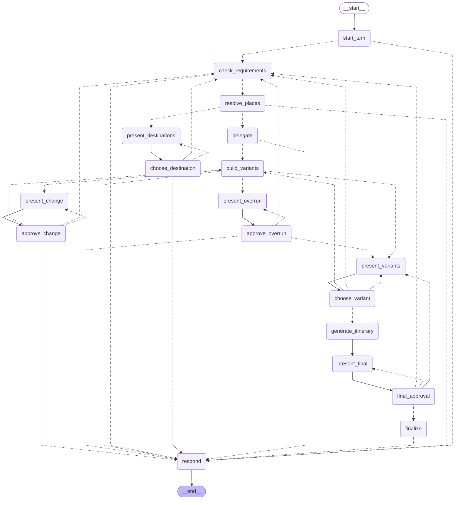

# Agent graph

Generated with `python -m vacation_agent.graph.orchestrator`. Dashed arrows = conditional routing (`Command(goto=...)`); `present_* -> choose_*/approve_*` pairs are the human-in-the-loop interrupts.

